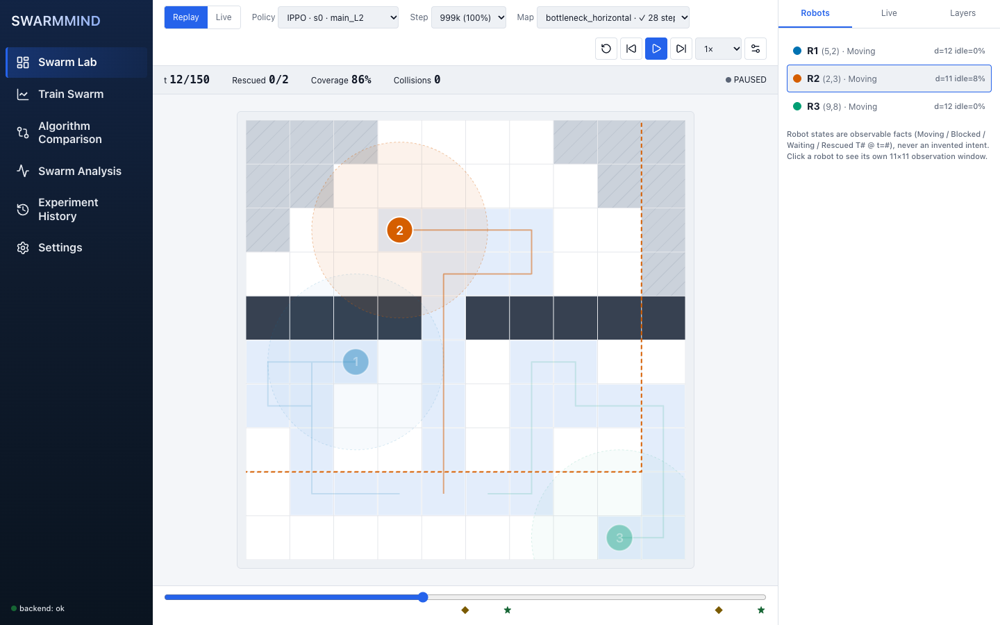

# SWARMMIND

**Multi-agent reinforcement learning for a robot-swarm search-and-rescue simulator** — a 2D grid world
where a team of robots, each seeing only a small window around itself, must explore an unknown map and
rescue targets. The project trains **IPPO** and **MAPPO** (PPO with independent vs. centralised critics),
compares them against a **Random** policy and a hand-written frontier heuristic under a pre-registered
protocol, and ships an interactive web UI to watch, replay, compare and train the swarms.



The authoritative design is [`SWARMMIND_TECHNICAL_SPEC.md`](SWARMMIND_TECHNICAL_SPEC.md). This README is the
operating manual; [`docs/ARCHITECTURE.md`](docs/ARCHITECTURE.md) explains how the pieces fit.

## What was found (and what was not)

Level L2 (10×10 grid, 3 robots, 2 targets, shared-map communication), 5 training seeds per algorithm,
about 1M environment steps each, evaluated on held-out maps. Full tables, intervals and the mechanical
decision for every hypothesis are in [`docs/RESULTS.md`](docs/RESULTS.md), which is generated, not written.

- **H1 supported.** Both learned policies solve the held-out test maps almost every time (success 1.00)
  where Random solves 0.44 of them — a difference of about +0.56 (95% CI excludes 0).
- **H2 not supported.** No detectable difference between MAPPO and IPPO in steps-to-completion
  (MAPPO − IPPO about −0.32 steps, CI spans 0). With 5 seeds per arm this is **not** evidence that they are equal.
- **Coordination emergence not shown.** Learned robots divide exploration more than Random (lower DER@50),
  but the pre-set criteria for "learned coordination" are not all met (redundant pursuit is higher than Random),
  so the project does not claim emergent cooperation. MAPPO is not claimed to be better than IPPO.
- **H4 (descriptive).** On unseen, differently structured maps IPPO keeps 0.83 and MAPPO 0.82 of their
  test success; Random keeps 0.33.

One level (L2), one configuration, 5 seeds: these are results for this simulator, not general claims about MARL.

## Quickstart

Setup time is dominated by downloading PyTorch (≈130 MB) and the npm packages: a cold-cache
setup took 26 minutes on the slow connection (≈140 kB/s) it was first verified on (`docs/phase_reports/PHASE_14.md`); it is
much faster with warm caches or a quicker link.

Requires **Python 3.11** and **Node.js 20.19+ or 22.12+** (npm). macOS or Linux (verified on macOS arm64 only).
The browser end-to-end run (`make e2e`) also needs a Chromium: it uses `chrome-headless-shell` from the puppeteer cache
(`~/.cache/puppeteer`) if present, otherwise Google Chrome, or whatever `CHROME_BIN` points to.

```bash
git clone <this repository> swarmmind && cd swarmmind
make setup          # .venv (Python 3.11), dependencies pinned by requirements.lock, npm ci (package-lock.json)
make demo           # installs the committed real demo data, builds the UI, starts backend + frontend
```

Then open **http://localhost:5173**. Ctrl-C stops both servers.

`make demo` first runs `scripts/demo_setup.sh`, which copies the committed bundle in `demo_data/`
(the 10 trained actors, study results and recorded replays of study `main_L2`; 38 MB) into `results/` and
verifies a SHA-256 for every file. It never overwrites a file that differs. Nothing in the demo is
mocked or generated at start-up: every chart, table and replay comes from those files.

If `npm` hangs on macOS, export `NODE_OPTIONS=--no-network-family-autoselection` (the Makefile already does).

### A guided 8-minute demo

[`docs/DEMO.md`](docs/DEMO.md) is a timed script: replay a trained MAPPO episode, run the same policy live on
a held-out map, compare algorithms, inspect behaviour, launch a real training job and watch its metrics.
`make e2e` performs the same flow in a headless browser and checks what the pages show against the results files.

## Checking everything

| Command | What it proves |
|---|---|
| `make lint` | ruff + mypy on the library packages |
| `make test` | fast Python suite: environment rules, PPO/IPPO/MAPPO maths, information-leak probes, evaluation, API, **integration tests against a real server** |
| `make test-slow` | learning smoke tests (IPPO/MAPPO actually learn the L1 task) |
| `make test-frontend` | Vitest, oxlint, and `npm run build` (which also fails on mock imports, raw design literals, stale generated types) |
| `make e2e` | headless-browser run of the demo flow on the production build → [`docs/E2E_REPORT.md`](docs/E2E_REPORT.md) |
| `make audit` | every reported number re-derived from a more primary file; the actors re-run on held-out maps → [`docs/REAL_DATA_AUDIT.md`](docs/REAL_DATA_AUDIT.md) |
| `make perf` | measured latencies and throughput → [`docs/PERFORMANCE.md`](docs/PERFORMANCE.md) |
| `make fresh-clone` | all of the above in a brand-new directory → [`docs/FRESH_CLONE_REPORT.md`](docs/FRESH_CLONE_REPORT.md) |

## Reproducing the study from scratch

The committed bundle lets you skip training. To retrain (hours: roughly 5–7 h per seed per algorithm on
a laptop CPU, with 4 workers in parallel):

```bash
make study STUDY=main_L2     # trains 5 seeds × {IPPO, MAPPO}, evaluates on held-out maps, aggregates
make report STUDY=main_L2    # regenerates results/studies/main_L2/summary.json and docs/RESULTS.md
```

The design (seeds, budgets, evaluation maps, statistical procedure, decision rules) was frozen before the
study in [`docs/EXPERIMENTS.md`](docs/EXPERIMENTS.md); deviations are recorded there. Training a single run
from the UI ("Train Swarm") or the CLI (`scripts/train.py --help`) uses the same trainer.

## Repository layout

```
marl/            the single source of truth (no web code): environment, algorithms, networks, training,
                 evaluation, analysis, replay format, experiment orchestration
backend/app/     FastAPI: thin routers + services over marl/ (REST + WebSockets), no ML logic of its own
frontend/        React + TypeScript + Vite: Swarm Lab (canvas), comparison, analysis, training, history, settings
                 frontend/e2e/  browser end-to-end run (Chrome DevTools protocol)
configs/         environment levels, algorithm defaults, frozen study configs, frozen evaluation maps
scripts/         train, evaluate, run_study, aggregate_results, audit_real_data, perf_check, demo_*, ...
tests/           env, marl, evaluation, analysis, experiments, replay, backend, integration
demo_data/       the committed real artifacts of study main_L2 (installed into results/ by demo_setup)
docs/            RESULTS (generated), EXPERIMENTS (pre-registration), API, ARCHITECTURE, DEMO, design/, audit reports
```

`results/` (6 GB of checkpoints and logs) and `*.pt` are git-ignored; everything needed to run the app and
verify the numbers is in `demo_data/`.

## Documentation

| Document | Contents |
|---|---|
| [`docs/ARCHITECTURE.md`](docs/ARCHITECTURE.md) | layers, data flow, the information boundary, parity guarantees, security posture |
| [`docs/RESULTS.md`](docs/RESULTS.md) | generated results for study `main_L2` |
| [`docs/EXPERIMENTS.md`](docs/EXPERIMENTS.md) | calibration, pre-registration, pilot evidence |
| [`docs/API.md`](docs/API.md) | REST + WebSocket reference (generated from the OpenAPI schema) |
| [`docs/DEMO.md`](docs/DEMO.md) | timed demo script |
| [`docs/design/`](docs/design) | UI spec, design system, polish checklist |
| [`docs/phase_reports/`](docs/phase_reports) | what was built, tested and found in each phase, including problems |
| [`docs/REAL_DATA_AUDIT.md`](docs/REAL_DATA_AUDIT.md), [`docs/E2E_REPORT.md`](docs/E2E_REPORT.md), [`docs/PERFORMANCE.md`](docs/PERFORMANCE.md), [`docs/FRESH_CLONE_REPORT.md`](docs/FRESH_CLONE_REPORT.md) | generated verification reports |

## Limitations

- One level (L2) and 5 seeds per algorithm were studied; L1/L3/L4 exist and train, but their results are not part of the evidence.
- Both learned policies saturate the L2 test maps, so success rate cannot separate them; the study reports
  steps-to-completion instead (a pre-registered deviation, documented in `docs/EXPERIMENTS.md`).
- A single-user local application: it binds to localhost and is not hardened for multi-user or public hosting.
- CPU only; no GPU path was tested. Browser verification used Chromium (headless); Safari and Firefox were not tested.
- No screen-reader walkthrough was performed (automated axe checks and a keyboard walk pass).
- Run manifests inside `demo_data/` keep the absolute checkpoint paths of the machine that trained them; the
  checkpoints themselves (≈250 MB per run) are not shipped, only each run's final actor.
