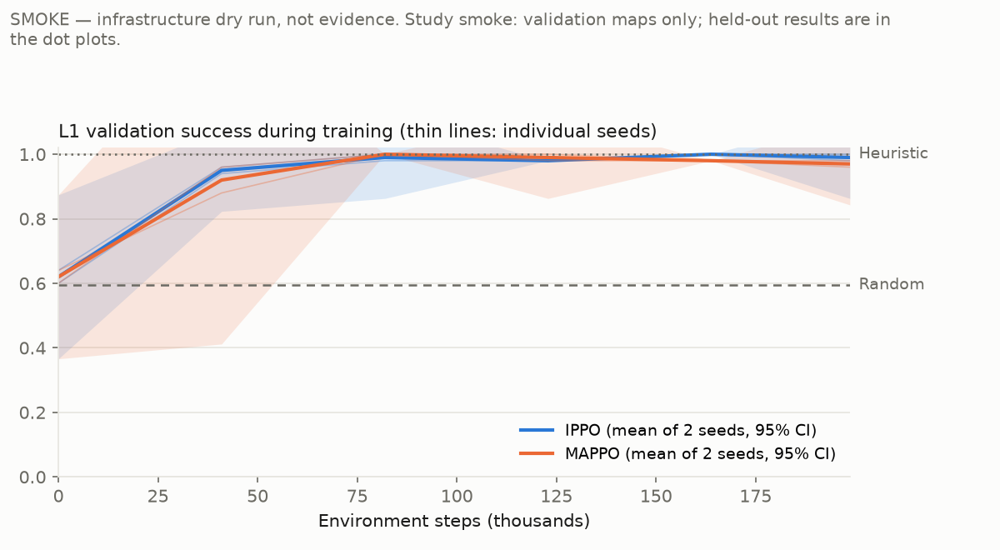
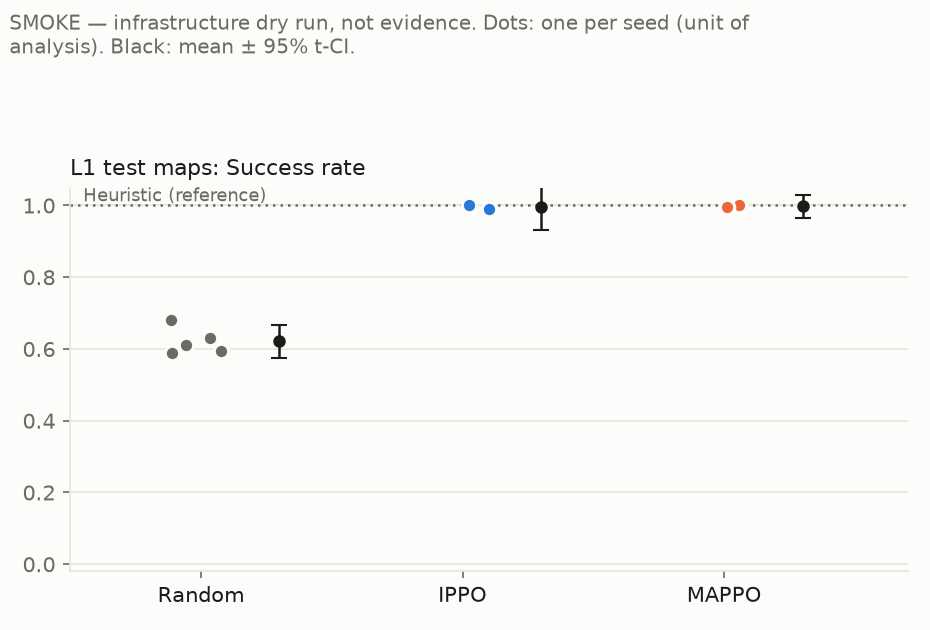
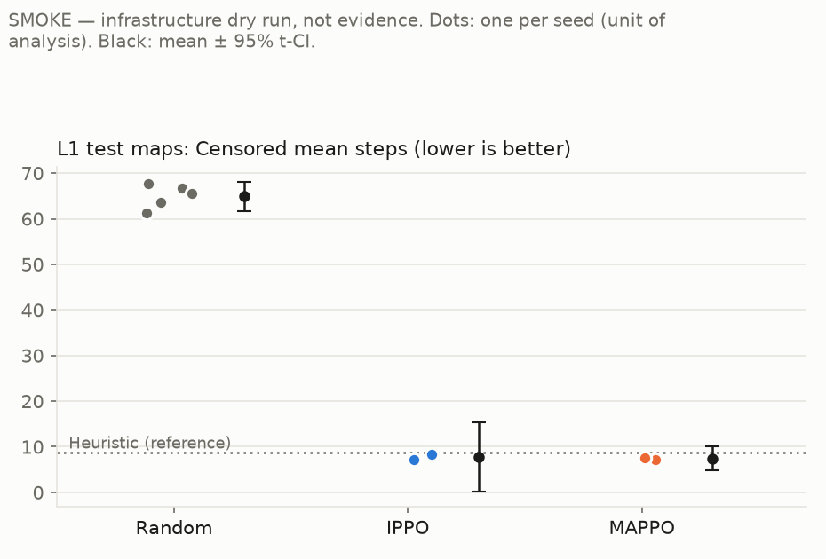

# SWARMMIND results — study `smoke`

> **SMOKE STUDY — infrastructure dry run. These numbers are NOT evidence for any hypothesis;
> they only show that training → held-out evaluation → aggregation → reporting runs end to end.**

*Generated by `scripts/aggregate_results.py` at 2026-09-24T08:33:23.539140+00:00 from `results/studies/smoke/summary.json`. Do not edit by hand (§34).*

**Protocol.** Unit of analysis: one training seed (learned) or one evaluation sampling seed (Random). Each seed's value is the mean over its held-out episodes (every map × evaluation seeds {0, 1}), final checkpoint, stochastic policy (greedy is secondary). Intervals are 95% t-intervals over seeds; differences use Welch 95% CIs with Hedges' g. With few seeds, a CI that includes 0 means *no detectable difference*, never equivalence. t-intervals are reported as computed, not clipped to a metric's range, so with few seeds a success-rate interval can extend past 0 or 1.

## Level L1

### Hypotheses (§4, decided mechanically)

- [SMOKE — infrastructure dry run, not evidence] H1 supported for IPPO: test success exceeds Random by +0.374 (95% Welch CI [+0.329, +0.419]).
- [SMOKE — infrastructure dry run, not evidence] H1 supported for MAPPO: test success exceeds Random by +0.376 (95% Welch CI [+0.331, +0.422]).
- [SMOKE — infrastructure dry run, not evidence] H2 not supported: no detectable difference between MAPPO and IPPO in test success (MAPPO − IPPO +0.003, 95% Welch CI [-0.032, +0.037]; Hedges' g +0.26). With 2 vs 2 seeds the power is low, so this is not evidence of equivalence.
- [SMOKE — infrastructure dry run, not evidence] H3 pending: DER@50 and the coordination metrics are computed in Phase 8 (§24); no coordination claim is made here.

### Test maps — stochastic (primary)

| Method | Seeds | Success | Censored steps | Steps (successes) | Coverage | Collisions /100 agent-steps | Return |
|---|---|---|---|---|---|---|---|
| Random | 5 | 0.62 [0.58, 0.67] | 64.9 [61.7, 68.1] | 43.5 [40.2, 46.8] | 0.79 [0.78, 0.81] | 4.23 [3.95, 4.50] | 2.06 [1.89, 2.24] |
| Heuristic (reference) | 1 | 1.00 (n=1) | 8.8 (n=1) | 8.8 (n=1) | 0.71 (n=1) | 0.00 (n=1) | 3.94 (n=1) |
| IPPO | 2 | 0.99 [0.93, 1.06] | 7.8 [0.2, 15.4] | 7.3 [5.6, 9.1] | 0.74 [0.72, 0.77] | 0.64 [0.50, 0.79] | 3.93 [3.66, 4.21] |
| MAPPO | 2 | 1.00 [0.97, 1.03] | 7.4 [4.9, 10.0] | 7.2 [6.8, 7.6] | 0.75 [0.67, 0.83] | 0.69 [-0.05, 1.44] | 3.95 [3.82, 4.08] |

### Test maps — greedy (secondary)

| Method | Seeds | Success | Censored steps | Steps (successes) | Coverage | Collisions /100 agent-steps | Return |
|---|---|---|---|---|---|---|---|
| IPPO | 2 | 0.99 [0.99, 0.99] | 7.9 [7.4, 8.4] | 7.0 [6.5, 7.5] | 0.75 [0.68, 0.83] | 0.44 [-1.16, 2.04] | 3.92 [3.91, 3.93] |
| MAPPO | 2 | 0.99 [0.99, 0.99] | 7.7 [6.2, 9.3] | 6.8 [5.2, 8.4] | 0.76 [0.69, 0.82] | 0.57 [-1.05, 2.20] | 3.92 [3.87, 3.97] |

**Differences, test / stochastic** (A − B, Welch 95% CI, Hedges' g)

| Comparison | success_rate | censored_steps | coverage | collisions_per_100_agent_steps |
|---|---|---|---|---|
| MAPPO − IPPO | +0.003 [-0.032, +0.037], p=0.712, g +0.26 | -0.372 [-5.645, +4.900], p=0.646, g -0.34 | +0.011 [-0.048, +0.070], p=0.324, g +0.92 | +0.049 [-0.591, +0.688], p=0.557, g +0.46 |
| IPPO − Random | +0.374 [+0.329, +0.419], p<0.001, g +9.61 | -57.104 [-60.418, -53.790], p<0.001, g -20.80 | -0.052 [-0.067, -0.036], p<0.001, g -3.86 | -3.584 [-3.859, -3.308], p<0.001, g -15.13 |
| MAPPO − Random | +0.376 [+0.331, +0.422], p<0.001, g +9.71 | -57.477 [-60.622, -54.331], p<0.001, g -21.19 | -0.041 [-0.069, -0.013], p=0.020, g -2.90 | -3.535 [-3.834, -3.236], p<0.001, g -14.68 |

**Differences, test / greedy** (A − B, Welch 95% CI, Hedges' g)

| Comparison | success_rate | censored_steps | coverage | collisions_per_100_agent_steps |
|---|---|---|---|---|
| MAPPO − IPPO | +0.000 (CI undefined; g n/a) | -0.165 [-1.295, +0.965], p=0.400, g -0.72 | +0.000 [-0.035, +0.036], p=0.969, g +0.03 | +0.133 [-0.639, +0.904], p=0.537, g +0.42 |

### Training (validation maps)

| Method | Untrained (step 0) success | Final validation success | Validation-success AUC |
|---|---|---|---|
| IPPO | 0.62 [0.37, 0.87] | 0.99 [0.86, 1.12] | 0.943 [0.854, 1.033] |
| MAPPO | 0.62 [0.37, 0.87] | 0.97 [0.84, 1.10] | 0.936 [0.895, 0.977] |

MAPPO − IPPO validation AUC: -0.008 [-0.059, +0.044], p=0.465, g -0.56

### Figures

