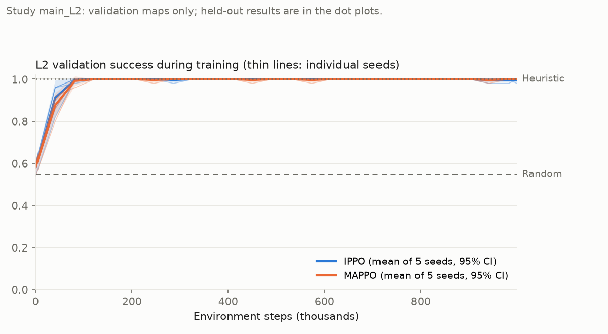
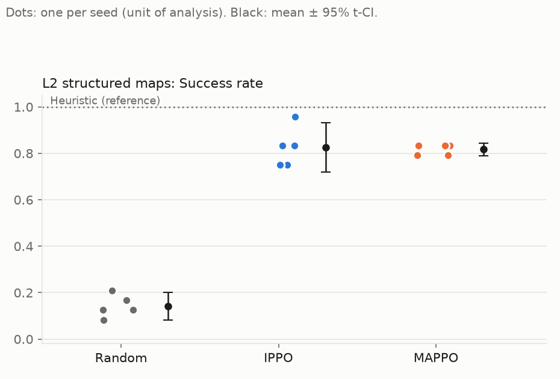
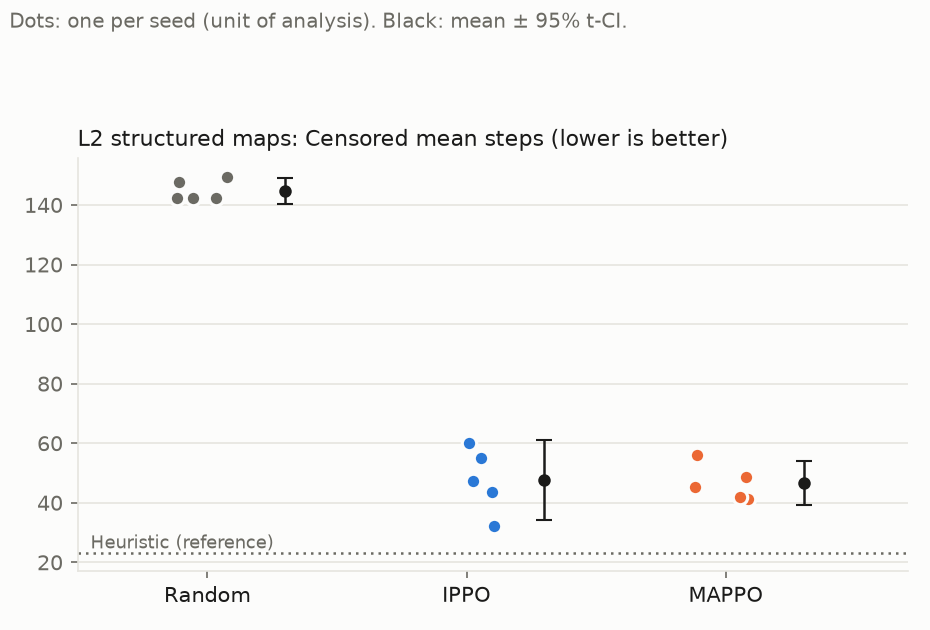
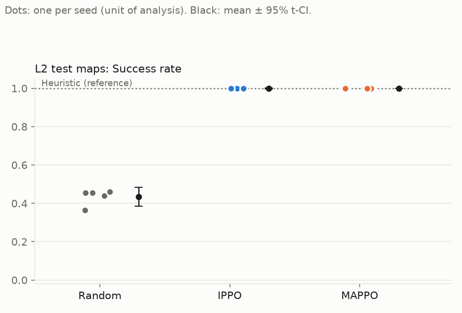
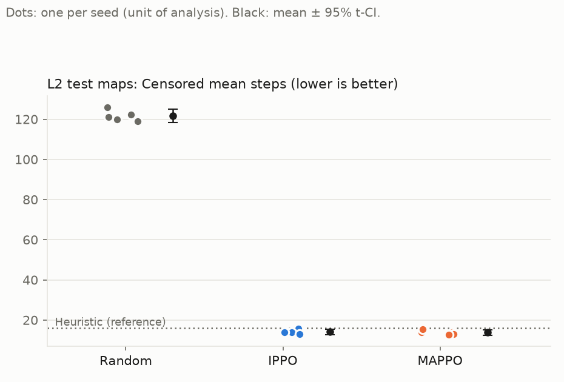

# SWARMMIND results — study `main_L2`

*Generated by `scripts/aggregate_results.py` at 2026-09-24T17:02:52.540138+00:00 from `results/studies/main_L2/summary.json`. Do not edit by hand (§34).*

**Protocol.** Unit of analysis: one training seed (learned) or one evaluation sampling seed (Random). Each seed's value is the mean over its held-out episodes (every map × evaluation seeds {0, 1}), final checkpoint, stochastic policy (greedy is secondary). Intervals are 95% t-intervals over seeds; differences use Welch 95% CIs with Hedges' g. With few seeds, a CI that includes 0 means *no detectable difference*, never equivalence. t-intervals are reported as computed, not clipped to a metric's range, so with few seeds a success-rate interval can extend past 0 or 1.

## Level L2

### Hypotheses (§4, decided mechanically)

- H1 supported for IPPO: test success exceeds Random by +0.564 (95% Welch CI [+0.515, +0.613]).
- H1 supported for MAPPO: test success exceeds Random by +0.565 (95% Welch CI [+0.516, +0.614]).
- H2 not supported: no detectable difference between MAPPO and IPPO in censored steps-to-completion (MAPPO − IPPO -0.315, 95% Welch CI [-1.802, +1.172]; Hedges' g -0.28). With 5 vs 5 seeds the power is low, so this is not evidence of equivalence.
- H3 pending: DER@50 and the coordination metrics are computed in Phase 8 (§24); no coordination claim is made here.
- H4 (descriptive, no threshold): IPPO keeps 0.83 of its test success on the structured maps (95% CI [0.72, 0.93]); MAPPO keeps 0.82 of its test success on the structured maps (95% CI [0.79, 0.85]); Random keeps 0.33 of its test success on the structured maps (95% CI [0.20, 0.46]).

### Test maps — stochastic (primary)

| Method | Seeds | Success | Censored steps | Steps (successes) | Coverage | Collisions /100 agent-steps | Return |
|---|---|---|---|---|---|---|---|
| Random | 5 | 0.44 [0.39, 0.48] | 121.6 [118.2, 125.0] | 84.7 [82.2, 87.3] | 0.86 [0.85, 0.87] | 4.99 [4.92, 5.07] | 1.84 [1.64, 2.04] |
| Heuristic (reference) | 1 | 1.00 (n=1) | 15.9 (n=1) | 15.9 (n=1) | 0.85 (n=1) | 0.00 (n=1) | 5.16 (n=1) |
| IPPO | 5 | 1.00 [1.00, 1.00] | 14.1 [12.8, 15.3] | 14.0 [13.0, 14.9] | 0.86 [0.86, 0.87] | 0.59 [0.39, 0.79] | 5.17 [5.15, 5.19] |
| MAPPO | 5 | 1.00 [1.00, 1.00] | 13.8 [12.5, 15.0] | 13.8 [12.5, 15.0] | 0.87 [0.86, 0.88] | 0.39 [0.13, 0.65] | 5.18 [5.16, 5.19] |

### Test maps — greedy (secondary)

| Method | Seeds | Success | Censored steps | Steps (successes) | Coverage | Collisions /100 agent-steps | Return |
|---|---|---|---|---|---|---|---|
| IPPO | 5 | 0.95 [0.93, 0.97] | 19.0 [15.8, 22.1] | 12.4 [11.9, 12.8] | 0.86 [0.86, 0.87] | 1.14 [0.76, 1.51] | 4.90 [4.80, 5.00] |
| MAPPO | 5 | 0.96 [0.93, 0.98] | 18.0 [14.4, 21.7] | 12.2 [11.9, 12.6] | 0.88 [0.86, 0.89] | 0.43 [-0.08, 0.93] | 4.98 [4.84, 5.11] |

**Differences, test / stochastic** (A − B, Welch 95% CI, Hedges' g)

| Comparison | success_rate | censored_steps | coverage | collisions_per_100_agent_steps |
|---|---|---|---|---|
| MAPPO − IPPO | +0.001 [-0.002, +0.004], p=0.374, g +0.57 | -0.315 [-1.802, +1.172], p=0.638, g -0.28 | +0.009 [-0.004, +0.022], p=0.123, g +1.07 | -0.195 [-0.471, +0.080], p=0.140, g -0.94 |
| IPPO − Random | +0.564 [+0.515, +0.613], p<0.001, g +18.05 | -107.525 [-110.843, -104.207], p<0.001, g -47.32 | +0.003 [-0.003, +0.010], p=0.271, g +0.69 | -4.407 [-4.603, -4.210], p<0.001, g -32.76 |
| MAPPO − Random | +0.565 [+0.516, +0.614], p<0.001, g +18.11 | -107.840 [-111.158, -104.522], p<0.001, g -47.42 | +0.012 [-0.000, +0.025], p=0.054, g +1.36 | -4.602 [-4.858, -4.346], p<0.001, g -27.01 |

**Differences, test / greedy** (A − B, Welch 95% CI, Hedges' g)

| Comparison | success_rate | censored_steps | coverage | collisions_per_100_agent_steps |
|---|---|---|---|---|
| MAPPO − IPPO | +0.006 [-0.023, +0.035], p=0.646, g +0.27 | -0.928 [-4.968, +3.112], p=0.610, g -0.30 | +0.012 [+0.000, +0.025], p=0.047, g +1.44 | -0.712 [-1.241, -0.183], p=0.015, g -1.80 |

### Structured maps — stochastic (secondary)

| Method | Seeds | Success | Censored steps | Steps (successes) | Coverage | Collisions /100 agent-steps | Return |
|---|---|---|---|---|---|---|---|
| Random | 5 | 0.14 [0.08, 0.20] | 144.8 [140.5, 149.1] | 114.7 [88.0, 141.3] | 0.73 [0.69, 0.78] | 7.69 [7.06, 8.32] | -0.33 [-0.66, -0.00] |
| Heuristic (reference) | 1 | 1.00 (n=1) | 23.2 (n=1) | 23.2 (n=1) | 0.96 (n=1) | 0.00 (n=1) | 5.11 (n=1) |
| IPPO | 5 | 0.82 [0.72, 0.93] | 47.6 [34.3, 61.0] | 25.9 [22.0, 29.8] | 0.90 [0.88, 0.92] | 2.60 [0.40, 4.79] | 4.03 [3.38, 4.68] |
| MAPPO | 5 | 0.82 [0.79, 0.85] | 46.6 [39.2, 54.1] | 23.3 [13.6, 33.1] | 0.90 [0.86, 0.93] | 1.26 [-0.08, 2.59] | 4.09 [3.88, 4.31] |

### Structured maps — greedy (secondary)

| Method | Seeds | Success | Censored steps | Steps (successes) | Coverage | Collisions /100 agent-steps | Return |
|---|---|---|---|---|---|---|---|
| IPPO | 5 | 0.70 [0.64, 0.76] | 57.8 [51.3, 64.3] | 18.2 [16.3, 20.1] | 0.86 [0.81, 0.92] | 2.86 [-1.42, 7.15] | 3.36 [2.78, 3.94] |
| MAPPO | 5 | 0.68 [0.64, 0.73] | 59.1 [52.6, 65.6] | 16.9 [16.1, 17.8] | 0.88 [0.83, 0.93] | 1.08 [-1.32, 3.47] | 3.47 [3.16, 3.77] |

**Differences, structured / stochastic** (A − B, Welch 95% CI, Hedges' g)

| Comparison | success_rate | censored_steps | coverage | collisions_per_100_agent_steps |
|---|---|---|---|---|
| MAPPO − IPPO | -0.008 [-0.113, +0.096], p=0.842, g -0.12 | -1.017 [-14.353, +12.320], p=0.859, g -0.11 | -0.005 [-0.039, +0.029], p=0.735, g -0.20 | -1.339 [-3.554, +0.877], p=0.194, g -0.83 |
| IPPO − Random | +0.683 [+0.577, +0.789], p<0.001, g +8.93 | -97.158 [-110.288, -84.029], p<0.001, g -10.98 | +0.169 [+0.128, +0.210], p<0.001, g +5.81 | -5.097 [-7.260, -2.935], p=0.002, g -3.54 |
| MAPPO − Random | +0.675 [+0.617, +0.733], p<0.001, g +16.36 | -98.175 [-105.668, -90.682], p<0.001, g -18.02 | +0.164 [+0.119, +0.209], p<0.001, g +4.82 | -6.436 [-7.755, -5.117], p<0.001, g -6.91 |

**Differences, structured / greedy** (A − B, Welch 95% CI, Hedges' g)

| Comparison | success_rate | censored_steps | coverage | collisions_per_100_agent_steps |
|---|---|---|---|---|
| MAPPO − IPPO | -0.017 [-0.078, +0.045], p=0.545, g -0.36 | +1.267 [-6.383, +8.916], p=0.713, g +0.22 | +0.017 [-0.044, +0.079], p=0.531, g +0.37 | -1.785 [-6.063, +2.494], p=0.350, g -0.58 |

### Training (validation maps)

| Method | Untrained (step 0) success | Final validation success | Validation-success AUC |
|---|---|---|---|
| IPPO | 0.58 [0.55, 0.61] | 1.00 [0.98, 1.01] | 0.950 [0.934, 0.965] |
| MAPPO | 0.58 [0.55, 0.61] | 1.00 [1.00, 1.00] | 0.943 [0.932, 0.953] |

MAPPO − IPPO validation AUC: -0.007 [-0.023, +0.009], p=0.335, g -0.59

### Figures

